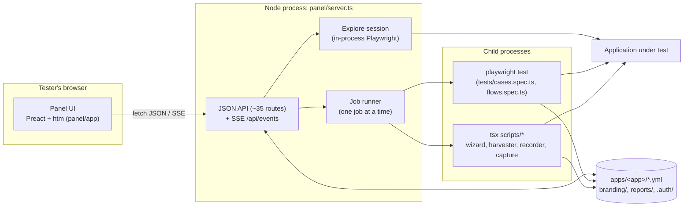

# Atimtha 0.1.0 — As-is architecture

Status: describes the code as received (build 0.1.0, source dated 31 Oct – 4 Nov 2026), plus the Phase 0 changes listed at the end.
Backlog reference: §1 "Produce an as-is architecture document describing the existing components and dependencies".

## 1. Summary

Atimtha 0.1.0 is a **single-user, local tool**. One Node.js process (the Control Panel) serves a Preact UI and a JSON API on
`127.0.0.1:4400`. Every browser task (collect, record, run, export) runs as a **child process** with `APP` / `ENV` / `LOCALE`
set, exactly like the CLI. All data is **YAML and JSON files** under the project folder; there is no database, no accounts
and no network service other than the panel itself.

## 2. Components

| Component | Location | Size | Responsibility |
| --- | --- | --- | --- |
| Panel UI | `panel/app/*.js`, `panel/index.html` | 326 KB | Projects home, 5 stages, wizard, Explore, generators, run history; English and Arabic (`i18n.js`, `i18n-ar.js`). No build step: ES modules + vendored `preact-htm.js`. |
| Panel server | `panel/server.ts` | 57 KB | Static files, JSON API, SSE event stream, job queue of one, Git init/commit, project zip import/export, code export download. |
| Request guard | `panel/security.ts` | new | Host allowlist, same-origin and JSON-only checks, security headers (see ADR-0002). |
| App registry | `src/core/app.ts` | 5 KB | Loads `app.yml` + `secrets.yml`, resolves `${ENV}` values, validates with `app.schema.json`, current project pointer. |
| Smart OR | `src/core/or/*` | 22 KB | Page/element schema, loader, locator resolver with fallbacks, generated TypeScript types. |
| Collection | `src/core/harvest.ts`, `visual.ts`, `drafts.ts` | 43 KB | Finds and classifies elements, pickers, messages; screenshots with element boxes; draft pages. |
| Explore | `src/core/explorer.ts` | 36 KB | Live browser session driven from the panel; suggests and runs next steps; saves workflows. |
| Recorder | `scripts/record.ts`, `src/core/recorder-inpage.js` | 20 KB | Headed browser with an in-page toolbar; writes pages, navigation edges and a case. |
| Test model and runner | `src/core/cases/*` | 50 KB | Case/step/outcome/data-row model, validation, templates (`{{data}}`, `{{var}}`, faker, dates), suites, chains, workflows, runner. |
| Navigation | `src/core/navigation.ts` | 3 KB | Page-to-page routes; shortest path for `open: navigate` pages. |
| Code export | `src/core/export/codegen.ts` | 53 KB | Generates a standalone Playwright + TypeScript project. |
| Smart reporter | `reporters/smart-reporter.ts` | 29 KB | Playwright reporter: branded HTML report, history (`summary.json`, last 50 runs), findings. |
| Execution targets | `config/targets.ts`, `docker/grid.compose.yml` | 6 KB | Local, Docker grid, BrowserStack, LambdaTest. |
| Code-test support | `src/pages`, `src/fixtures`, `src/data`, `src/utils` | 27 KB | BasePage, fixtures (`ui`, `data`, `api`), seeded data builders, helpers. |
| Demo app | `demo-app/` | 30 KB | Local site on port 4173 used by the sample projects. |

## 3. Runtime processes

1. `npm run panel` → `tsx panel/server.ts` (one process, port 4400, bound to 127.0.0.1).
2. Per job, the panel spawns `node node_modules/@playwright/test/cli.js test …` or `node node_modules/tsx/dist/cli.mjs scripts/<x>.ts …`.
   Only one job runs at a time; output streams to the UI over SSE.
3. Explore runs Playwright **inside** the panel process (one session at a time, guarded by `explorer.busy`).
4. Test runs start the demo app themselves when the environment has `startDemoApp: true`.

## 4. Data and storage

All persistent state is files; the logical model is the 19-entity ERD (`atimtha Automation Studio — ERD`).

| What | Where | In Git |
| --- | --- | --- |
| Project, environments, login, users | `apps/<app>/app.yml` | yes |
| Passwords, basic-auth | `apps/<app>/secrets.yml` or `${ENV_VAR}` | no |
| Pages and elements | `apps/<app>/or/*.page.yml` | yes |
| Cases, workflows, suites, navigation, messages | `apps/<app>/cases`, `flows`, `suites.yml`, `navigation.yml`, `messages.yml` | yes |
| Sessions | `.auth/<app>/<user>.json` | no |
| Reports and history | `reports/` | no |
| Branding profiles | `branding/profiles.yml` | yes |

Integrity is enforced by JSON schemas (AJV) and loaders at read time and by `npm run validate` in CI — not by a database.

## 5. External dependencies

| Dependency | Version | Used for |
| --- | --- | --- |
| Node.js | 22 in CI (24 verified locally) | Runtime |
| @playwright/test | 1.63.0 (pinned) | Browser automation, test runner, reporter API |
| tsx | ^4.23 | Runs TypeScript without a build |
| TypeScript | ^5.9 | Type checking (`npm run typecheck`) |
| Preact + htm | vendored | Panel UI |
| yaml, ajv | ^2.9, ^8.20 | File formats and schema validation |
| @faker-js/faker | ^10.6 | Seeded test data |
| adm-zip | ^0.6 | Project import/export, code export |
| dotenv, cross-env | — | Environment handling |

## 6. Interfaces

- **HTTP API** (panel only, not versioned, not documented as a public contract): `/api/projects`, `/api/state`, `/api/run`,
  `/api/cases/*`, `/api/flows/*`, `/api/explore/*`, `/api/harvest`, `/api/record`, `/api/history`, `/api/discoveries`,
  `/api/branding`, `/api/git`, … plus static `/report/*`, `/history/*`, `/visual/*`.
- **CLI** (`package.json` scripts) — the CI contract: `npm run validate`, `npm test`, `npx playwright test --shard`.
- **Files** — the YAML formats above are the de-facto data contract and must stay backward compatible (backlog §5, §15).

## 7. Known limitations (inputs to the target architecture)

| Area | Limitation |
| --- | --- |
| Users | No accounts, roles or audit; whoever runs the process has full access. |
| Scale | One job and one Explore session at a time; one machine. |
| Data | Files only; renames rewrite references; no history except Git. |
| API | Unversioned, unauthenticated, one 57 KB file; errors returned as `400 {error}`. |
| Tests | Before Phase 0 there were no unit or component tests of Atimtha itself. |
| Git commit | 0.1.0 staged with `git add -A` and blocked only three secret file names (fixed in Phase 0, ADR-0004). |
| Observability | Console output only; no structured logs, metrics or health endpoint. |
| Engines | Web only. API testing is limited to a setup helper (`src/utils/api-client.ts`). |

## 8. Phase 0 changes since the zip

| Change | Files | Status |
| --- | --- | --- |
| Panel request guard and security headers | `panel/security.ts`, `panel/server.ts` | Implemented, Tested (unit) |
| Unit test harness (`npm run test:unit`, node:test + tsx) | `tests/unit/*`, `package.json` | Implemented, Tested |
| Panel Git commit: project files only, explicit paths, secret check by name and content | `panel/git-guard.ts`, `panel/server.ts`, `panel/app/settings.js` | Implemented, Tested (unit) |
| Fix: Git and branding modals were trapped in the 52 px top bar (its `backdrop-filter`), now rendered beside it | `panel/app/main.js` | Implemented, checked in the browser |
| Browser integration tests: page collection and generators on the demo app (`npm run test:integration`) | `tests/integration/*` | Implemented, Tested |
| Threat model | `docs/security/threat-model.md` | Written |
| Input limits: request size, child-process arguments, static path check, zip import limits | `panel/limits.ts`, `panel/server.ts`, `tests/unit/limits.test.ts` | Implemented (tests written, not run) |
| Security CI: npm audit, gitleaks (full history), CycloneDX SBOM | `.github/workflows/security.yml` | Implemented (not run yet) |
| Self-healing governance: `run.healing` pass / flag / off, structured heals with the original failure, healing gate, report counts (ADR-0011) | `src/core/healing.ts`, resolver, base page, fixtures, runner, reporter, `app.schema.json` | Implemented (tests written, not run) |
| PostgreSQL physical data model, first migration (ADR-0012) | `db/migrations/0001_initial_schema.*.sql`, `docs/architecture/physical-data-model.md` | Draft, not applied |
| Report XSS integration test (T9) | `tests/integration/report-xss.test.ts` | Written, not run |
| ADRs 0001–0004 accepted, 0005–0010 proposed | `docs/adr/*` | Written |
