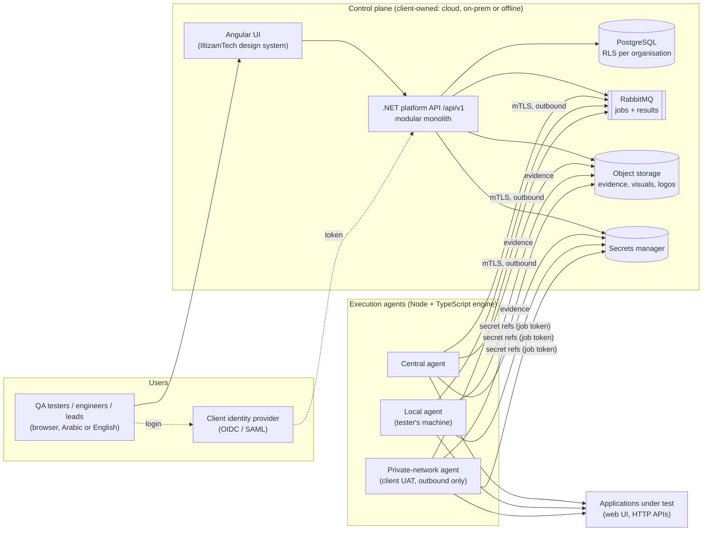

# Atimtha — target architecture (1.0)

- Status: Version 1, 2026-11-18. Based on accepted ADRs 0005–0014.
- Backlog reference: §1 Product architecture and technical leadership
- Read with: [as-is architecture](as-is-0.1.0.md), [physical data model](physical-data-model.md), [ADRs](../adr/README.md), [threat model](../security/threat-model.md)

## 1. Summary

Atimtha 1.0 is a **client-owned platform**: a central control plane (.NET modular monolith, PostgreSQL, RabbitMQ,
object storage, Angular UI) and **execution agents** (Node + the 0.1.0 TypeScript engine) that run tests wherever the
application under test can be reached: next to the platform, on a tester's machine, or inside a client's private
network. 1.0 ships the **web** and **API** engines; mobile and performance follow in 1.1 on the same contract.



## 2. Logical components and ownership

| Bounded context | Owns (tables) | Responsibilities | Owner team |
| --- | --- | --- | --- |
| **Identity & access** | `user_account`, `role`, `permission`, `membership` | Sign-in via OIDC, sessions, MFA/SSO foundations, roles, permission checks | Backend |
| **Workspaces & projects** | `organization`, `workspace`, `project`, `environment`, `test_user`, `expected_message`, `branding_profile` | Tenant structure, project settings, environments, branding | Backend |
| **Test assets** | `page`, `element`, `locator_fallback`, `page_visual`, `navigation_edge`, `login_config`, `test_case`, `test_step`, `data_row`, `workflow*`, `run_suite*` | Smart OR, cases, workflows, suites; YAML import/export | Backend + engine |
| **Versioning & review** | `asset_version`, `change_set` | Immutable versions, offline drafts as change sets, conflict detection, approval | Backend |
| **Execution** | `execution_agent`, `execution` | Job queue, agent registry and health, scheduling, cancellation, concurrency limits | Backend + DevOps |
| **Results & evidence** | `test_result`, `healing_event`, `evidence` | Results ingestion, Smart Report, trends, comparisons, healing analytics, evidence permissions | Backend + frontend |
| **Integrations** | `integration`, `feature_flag` | Git, CI, Jira first; feature flags | Backend |
| **Audit** | `audit_log` | Append-only record of sensitive operations | Backend + security |
| **Engines** (agent side) | — | Web engine (0.1.0 code), API engine (new), validation, export | Engine team |

Rule: a module reads and writes only its own tables; it calls another module through that module's service interface.
CI enforces it with an architecture test (namespace dependencies) in the .NET solution.

## 3. Control plane and distributed execution

1. A tester starts a run in the UI → `POST /api/v1/projects/{id}/executions`.
2. The platform freezes the **project snapshot** (the current versions of every asset), writes an `execution` row
   (`queued`) and publishes a **job** (ADR-0014) to the queue for agents with the right capabilities and network
   reach (environment → agent pool).
3. An agent pulls the job over its outbound mTLS connection, checks the signed job token and expiry, materialises the
   snapshot as an `apps/<key>/` folder, resolves secret references, and runs the engine's runner. It cannot run
   anything the job does not describe.
4. Results and evidence stream back as events; the platform stores them and pushes live status to the UI.
5. Heartbeats every 15 s; a job whose agent goes silent is requeued once, then marked `error` (infrastructure, not
   an application failure). Cancellation and timeouts are job messages.

## 4. Deployment models (ADR-0008)

| Model | What runs where | Notes |
| --- | --- | --- |
| **Cloud (client tenancy)** | Control plane on a VM with Docker Compose; central agents beside it | TLS at a reverse proxy; managed PostgreSQL optional |
| **On-premises** | Same Compose package on a client server | Client IdP; agents in the client network |
| **Offline / air-gapped** | Offline bundle: saved images, Compose file, migrations, browsers | No internet at install or run time |
| **Local tester mode** | The 0.1.0 Control Panel keeps working standalone | Projects can be imported to the platform later |

Every release ships versioned images, the Compose file, an offline bundle, an SBOM and install/upgrade/rollback guides.

## 5. Collaboration model (ADR-0007)

- Central edits create a new **immutable version** of the asset; the author and time are recorded.
- Offline (agent or local panel without the centre), testers edit **drafts**. On reconnect each draft becomes a
  **change set** that records the version it started from.
- **Conflict** = the base version moved on. The reviewer sees both versions and decides; nothing merges automatically.
- A change set cannot be approved by its author. Local execution keeps working while the centre is unavailable;
  results upload when it is back.

## 6. Unified testing architecture

| Engine | 1.0 | Runs on | Test model |
| --- | --- | --- | --- |
| Web (Playwright) | Yes (0.1.0 engine) | Agents with browsers | Pages, elements, steps, data rows, workflows |
| API (HTTP) | Yes (new) | Any agent | Requests, assertions, variables, data rows, chains |
| Mobile (Appium) | 1.1 | Agents with devices/emulators | Same case/row/result model |
| Performance (k6) | 1.1 | Isolated performance agents with load limits | Scripts, load profiles, thresholds |

All engines share: test case → data rows → results, the result statuses and failure categories, evidence, the job
contract and the report.

## 7. Standards

**API**: REST under `/api/v1`, JSON, RFC 9457 problem details for every error, OpenAPI document, cursor pagination,
`If-Match` / version numbers for edits, idempotency keys on run requests. Breaking changes → `/api/v2`.

**Errors**: validation 400 (field errors listed), not signed in 401, no permission 403, not found 404 (also for other
organisations' data: existence is never revealed), conflict 409 (version moved on), too large 413.

**Logging and tracing**: structured JSON logs; W3C trace context from the UI through the API and the queue to the
agent; every log line carries trace id, organisation id and user or agent id; never secrets or personal data from
test evidence.

**Observability**: `/health/live`, `/health/ready` (database, queue, storage); metrics for queue depth, job duration,
agent heartbeats, failure categories; dashboards in the deployment package.

## 8. Database migration and compatibility

- SQL migrations in `db/migrations/NNNN_name.up.sql` / `.down.sql`, applied by `Atimtha.Api migrate` and recorded in
  `atimtha.schema_migration` (ADR-0013). Forward-only in production; down scripts for development and failed installs.
- Expand → migrate → contract for breaking changes: add new columns, backfill, switch code, drop old in a later release.
- 0.1.0 compatibility: YAML import/export through business keys (ADR-0012); bundled projects are the migration fixtures.

## 9. Versioning

| Thing | Scheme |
| --- | --- |
| Platform, agents, UI | Semantic version per release; agents report theirs, the platform refuses incompatible ones |
| Job/result contract | `atimtha.job/N` (ADR-0014) |
| API | URL major version (`/api/v1`) |
| Projects, pages, cases, workflows, suites | `asset_version` integer per asset, immutable, with SHA-256 |
| Execution configuration | Stored on the `execution` row (locale, target, healing policy, seed, selection) so a run can be reproduced |
| Database | Migration number |

## 10. Engineering standards

- **Branching**: `main` is releasable; work on short-lived branches (`phase0/…`, `feature/…`), merged by pull request.
- **Review**: one approving review; the author does not approve their own PR; ADR required for decisions in §2–§9.
- **Merge**: only when every required check is green (build, unit, integration, security workflow).
- **Staging**: explicit paths only; secrets never committed (panel guard, gitleaks in CI).
- **Releases**: tagged `vX.Y.Z`, release notes, SBOM, migration notes, rollback steps.
- **Definition of Done**: as in the backlog (tests, docs, review, QA, security, bilingual, deployment notes).

## 11. Repository layout (target)

```
/                     0.1.0 framework and engine (TypeScript) — becomes the agent's engine package
/platform             .NET solution: Atimtha.Api (host + modules), tests
/web                  Angular UI (next)
/agent                Node execution agent (next)
/db/migrations        SQL migrations (source of truth)
/contracts            JSON Schemas for jobs and results (next)
/deploy               Docker Compose, offline bundle scripts
/docs                 product, architecture, ADRs, security
```
